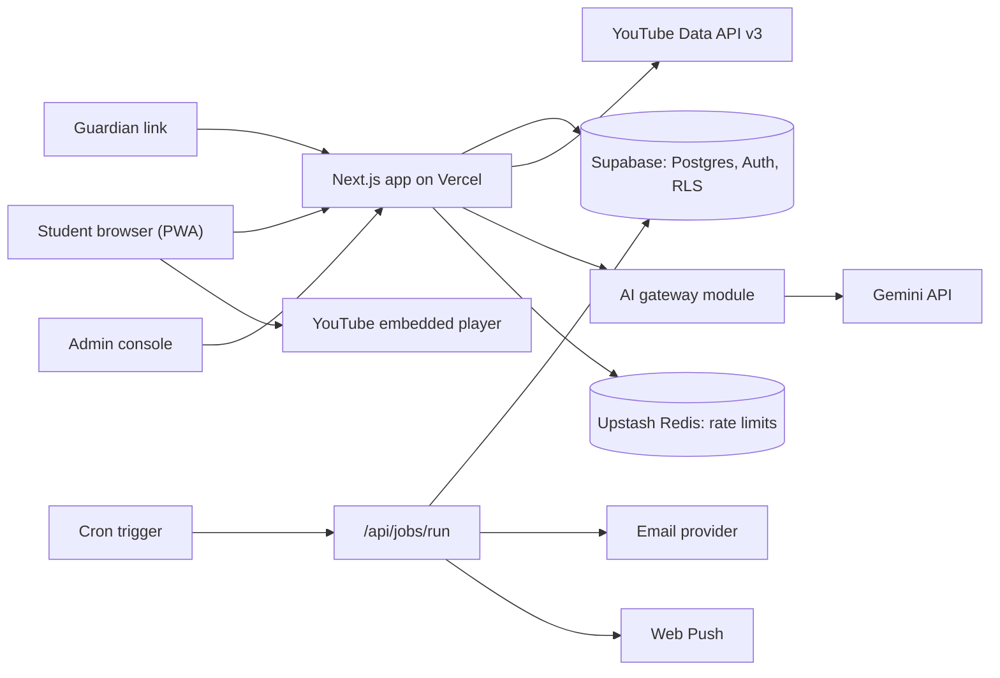
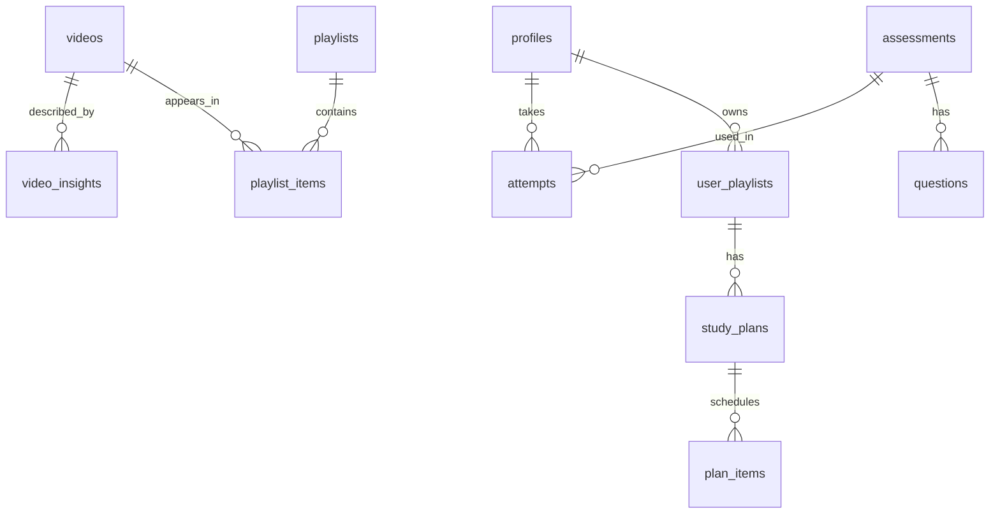

# architecture.md — Dishari (working title)

Version 1.0 · 17 November 2026
Audience: the AI coding agent (Google Antigravity) and the founder.
Companion files: `phases.md` (build order and acceptance tests), `design.md` (UI and UX).

Tags used below: **[V]** verified in research with a source, **[A]** assumption to verify, **[R]** recommendation. Where a library, model name or API detail may have changed, the agent must check the current official documentation before relying on it.

---

## 1. What we are building

A web app (installable PWA) for Bangladeshi school and college students.

**Core loop**

1. The student pastes a YouTube playlist link (a chapter, a full course, any subject).
2. The student chooses study preferences: start date, study days and time windows, pace or deadline, and how often they want a **quiz** and an **assignment** (after every class, every 2 classes, every 3 classes, at the end, or never).
3. The app reads the playlist, measures every video, and builds a **dated class-by-class schedule** (the "Pathway").
4. The student studies each class in the app (embedded YouTube player), then takes the quiz or assignment that the schedule says is due.
5. If the student misses sessions, the app **re-plans** without piling work up.

**Later (see phases.md, Phase 8):** curated NCTB-aligned paths, diagnostics and mastery tracking, teacher/classroom mode, multi-playlist timetables, paid tier.

### Glossary

| Term | Meaning |
|---|---|
| Playlist | A YouTube playlist, identified by its playlist ID |
| Class | One unit of study: usually one video, or a group of short videos, or one part of a very long video |
| Plan | A schedule built from one playlist and one set of preferences (versioned) |
| Plan item | One scheduled block: class, quiz, assignment, review, weekly test or buffer |
| Check | A quiz or an assignment attached to one or more classes |
| Insight | AI-generated short notes about a video (topics with timestamps, key points, formulas) |
| Assessment | A set of questions (quiz, review set, weekly test) or an assignment |

---

## 2. Principles (the agent must follow these)

1. **Deterministic core, AI at the edges.** The schedule is computed by a pure function. AI explains, enriches and generates content; it never decides dates.
2. **Embed, never copy.** Playback only through the official YouTube embedded player. No downloading, re-hosting, scraping, or republishing of lecture content.
3. **UTC in the database, local time on screen.** Default timezone `Asia/Dhaka`.
4. **Shared cache, private progress.** Video metadata and generated insights are shared across users. Progress, attempts and notes are private.
5. **Cheap by default.** Lazy AI generation, caching, quotas, a global spend kill-switch.
6. **Child-safe by default.** Assume most users are under 18. Minimal data, no ads, no ad trackers, guardian consent.
7. **Fail soft.** Every YouTube or AI failure has a visible fallback and a plain-language message.
8. **Everything testable.** Pure modules, recorded fixtures, no hidden network calls in unit tests.

---

## 3. System context



---

## 4. Stack decisions

| Layer | Choice | Why | Alternative |
|---|---|---|---|
| App framework | Next.js (App Router), TypeScript strict | One language for UI, API routes and the scheduler; easy for an agent to build and test | Separate FastAPI service (add later only for SymPy) |
| UI | Tailwind CSS + shadcn/ui (Radix) themed with the tokens in `design.md` | Accessible primitives, fast to build | Plain CSS modules |
| Database and auth | Supabase (Postgres, Auth, Row Level Security) | Managed, free tier, RLS fits private progress | Neon plus a separate auth library |
| DB access | Supabase CLI SQL migrations, generated types, `supabase-js` | Fewer moving parts than an ORM | Drizzle |
| Validation | Zod for env, API inputs, AI outputs | One schema language everywhere | Valibot |
| Dates | Luxon with IANA zones | Reliable timezone maths | date-fns-tz |
| Server state | TanStack Query | Caching, retries, optimistic updates | SWR |
| Forms | react-hook-form with Zod resolver | Wizards and validation | Native forms |
| i18n | next-intl, locales `bn` and `en` | App Router support | i18next |
| Maths rendering | KaTeX | Fast, small | MathJax |
| Answer checking | mathjs for numeric and algebraic equivalence in the MVP; optional Python FastAPI plus SymPy service later [R] | Keeps the MVP single-language | SymPy from day one |
| AI | Gemini API through the `AiGateway` interface; model names come from env, never hardcoded | Gemini can read public YouTube videos by URL [V, S34] | Any provider behind the same interface |
| Jobs | `jobs` table plus a protected worker route triggered by cron; claim rows with `FOR UPDATE SKIP LOCKED` | Works on free hosting tiers | Inngest or Trigger.dev when volume grows |
| Rate limiting | Upstash Redis (`@upstash/ratelimit`), with a Postgres fallback | Cheap, serverless-friendly | In-memory (not acceptable in production) |
| Email, push | Resend, Web Push (`web-push`, service worker) | Low cost | SMS later (needs a local aggregator quote) |
| Errors, logs | Sentry, structured logs (pino) | Cheap, quick | Heavier observability stacks |
| Tests | Vitest, fast-check (property tests), Playwright, MSW or fixtures | Covers pure logic and end-to-end | Jest |
| Hosting | Vercel (web), Supabase region closest to Bangladesh (Singapore is typically the nearest [A]) | Low ops | Container host or VPS |

**Do not add** Kubernetes, microservices, GraphQL, an ORM, Redux, or a vector database in the MVP.

---

## 5. Repository layout and module boundaries

```
dishari/
  AGENTS.md                      standing instructions for agents (see starter-prompt.md)
  docs/                          phases.md, architecture.md, design.md
  supabase/
    migrations/                  SQL migrations (timestamped)
    seed.sql
  src/
    app/                         Next.js routes (pages and route handlers)
    modules/
      youtube/                   URL parsing, API client, import service, quota guard
      scheduler/                 PURE. types, normalize, group, pack, feasibility, replan, explain, ics
      plans/                     create, read, update plans (uses scheduler)
      learning/                  progress, today view, spaced review, catch-up detection
      assessments/               generation orchestration, verification, grading
      ai/                        gateway, prompts, schemas, evals
      notifications/             reminders, email, push
      consent/                   age gate, guardian consent, retention, export, delete
      admin/                     review queue services
    components/                  UI components (design system from design.md)
    lib/                         env (zod), db client, logger, rate limit, i18n, time helpers
    styles/                      tokens.css, globals.css
  tests/
    unit/  integration/  fixtures/
  e2e/                           Playwright specs
```

**Dependency rules (enforce with ESLint `no-restricted-imports`)**

- `modules/scheduler` imports nothing from Next.js, Supabase, the network, or other modules. Inputs and outputs are plain JSON. Time zone work uses Luxon only.
- `modules/ai` is the only code allowed to call a model provider.
- `modules/youtube` is the only code allowed to call the YouTube Data API.
- UI components never import from `modules/*` directly; they call route handlers or server actions. **One exception:** `modules/scheduler` is pure and runs in the browser, so client components may import it for the instant plan preview (see `design.md` section 7.3). The server always recomputes the schedule on save and never trusts a client-computed plan.
- Every route handler validates input with Zod and returns typed errors.

---

## 6. YouTube integration

### 6.1 Accepted input and parsing

Accept: `youtube.com/playlist?list=…`, `youtube.com/watch?v=…&list=…`, `m.youtube.com/…`, `youtu.be/…?list=…`, or a bare playlist ID. Hostname allow-list: `youtube.com`, `www.youtube.com`, `m.youtube.com`, `youtu.be`. Extract the `list` parameter and validate it against `^[A-Za-z0-9_-]{10,64}$`.

Reject with a friendly message: auto-generated mixes (IDs starting with `RD`), empty IDs, other hosts. **Never fetch an arbitrary URL.** The only outbound call from user input is a YouTube Data API request with the extracted ID (this prevents SSRF).

### 6.2 Import pipeline

1. `playlists.list` (`snippet,contentDetails`) → title, channel, item count.
2. `playlistItems.list` (`snippet,contentDetails`, `maxResults=50`, page with `nextPageToken`) → video IDs, positions, titles. Private or deleted items appear with placeholder titles.
3. `videos.list` (`contentDetails,status,snippet`, up to 50 IDs per call) → ISO-8601 duration, `embeddable`, `privacyStatus`, live state, thumbnails, channel.
4. Upsert `playlists`, `videos`, `playlist_items`. Return a preview.

**Quota maths [V, S30, S31]:** list calls cost 1 unit each; the default project allowance is 10,000 units a day for everything except `search.list`, which is capped at 100 calls a day. A 100-video playlist costs about 5 units (1 + 2 + 2). **Do not use `search.list`.** Public and unlisted playlists can be read with an API key; private playlists need OAuth and are out of scope.

**Guards:** per-user limit of 10 imports an hour; global daily unit counter; at 80% of quota switch to cache-only mode with a friendly message; maximum `MAX_PLAYLIST_VIDEOS` (default 300) per plan.

### 6.3 Caching and the 30-day rule

YouTube's developer policies, as summarised in secondary sources, require API-derived data to be refreshed or deleted within about 30 days [S33; **verify in the official policy text**]. Therefore:

- Every row from the API has `fetched_at` and `metadata_expires_at = fetched_at + 25 days`.
- A daily job refreshes rows referenced by active plans. Rows not referenced by any plan and older than 30 days have their API-derived fields cleared or the rows deleted.
- Our own annotations (insights, assessments, schedules) live in separate tables and are keyed by the YouTube video ID.
- Do not compute new "quality scores" from YouTube statistics. Quality signals come from our own user feedback and human review.

### 6.4 Edge cases

| Case | Behaviour |
|---|---|
| Private, deleted or blocked video | Mark `unavailable`; exclude from the schedule by default; show a banner with a one-tap "include anyway" is NOT offered; user can remove it |
| Live stream, premiere, duration 0 | Exclude and warn |
| Not embeddable | Keep in schedule with `embed=false`; show "Watch on YouTube" link out |
| Duplicate video IDs | Keep the first; warn; toggle to keep all |
| Very short videos (under 5 min) | Offer auto-grouping into blocks (see 7.2) |
| Very long video (over one session) | Offer splitting into parts at reviewer or description timestamps, else equal parts |
| Age-restricted or region-blocked | Detected at runtime by player error events; show "Watch on YouTube" |
| Playlist over the cap | Offer to import the first N videos or choose a range |
| Order not sequential | Deterministic pass detects numbering (see 8.2); user can reorder by drag in the preview |

### 6.5 Playback requirements

- Use the IFrame Player API with the privacy-enhanced domain (`youtube-nocookie.com`), `rel=0`, `playsinline=1`, `enablejsapi=1`.
- Player at least 200 by 200 px, recommended 480 by 270 or larger; never overlay, obscure or alter it; no autoplay without a user action [V, S32].
- Show channel name with a link and an "Open on YouTube" link on every class page.
- Listen to `onStateChange` and `onError`. Save `lastPosition` at most every 15 seconds and on pause or end. Mark a class complete when the student presses **Mark done** or reaches 90% of the video.

### 6.6 Compliance rules (non-negotiable)

1. No downloads, no re-hosting, no clipping or re-dubbing, no transcript scraping.
2. Do not put YouTube playback behind a paywall. Paid features may only sell non-YouTube value.
3. Store only video IDs plus our own short, original-wording annotations. No transcripts, no long summaries.
4. Credit the creator on every class page. Provide a takedown or opt-out form; honour opt-outs within 48 hours.
5. Have a lawyer review this section before public launch.

---

## 7. Scheduling engine (`modules/scheduler`)

### 7.1 Contract

```ts
type Weekday = 'mon'|'tue'|'wed'|'thu'|'fri'|'sat'|'sun';
type Window = { start: string; end: string };              // "HH:mm" local, end > start, same day
type Availability = Record<Weekday, Window[]>;
type Cadence = { every: number } | { at: 'end' } | { at: 'none' };

interface Video { id: string; title: string; durationSec: number; position: number;
                  available: boolean; embeddable: boolean; }

interface Prefs {
  timezone: string;                    // IANA, default 'Asia/Dhaka'
  startDate: string;                   // 'YYYY-MM-DD'
  pacing:
    | { mode: 'availability' }                       // fastest: fill every available slot
    | { mode: 'classesPerWeek'; value: number }
    | { mode: 'minutesPerDay'; value: number }
    | { mode: 'deadline'; deadline: string };
  availability: Availability;
  playbackSpeed: 1 | 1.25 | 1.5 | 1.75 | 2;
  studyFactor: number;                 // 1.0–1.5: extra time for pauses and notes
  grouping: { mode: 'one-per-class' } | { mode: 'auto-group'; targetMin: number; maxMin: number };
  splitLongClasses: boolean;
  maxClassesPerDay: number;            // default 2
  breakMinutes: number;                // default 5
  quiz: { cadence: Cadence; questions: 5|10|15|20 };
  assignment: { cadence: Cadence; minutes: number };    // default 30
  review: { enabled: boolean; offsetsDays: number[]; microMinutes: number; maxDailyMinutes: number };
  weeklyTest: { enabled: boolean; weekday: Weekday; minutes: number };
  buffer: { mode: 'none' } | { mode: 'weekly-day' } | { mode: 'ratio'; value: number };
  blackoutDates: string[];
}

type ItemType = 'class'|'quiz'|'assignment'|'review'|'weekly_test'|'buffer';
interface PlanItem { id: string; seq: number; type: ItemType; date: string; start: string; end: string;
  durationMin: number; videoIds?: string[]; part?: { index: number; of: number; fromSec: number; toSec: number };
  covers?: number[]; dueDate?: string; label: string; }

interface PlanResult {
  items: PlanItem[];
  summary: { classes: number; videoMinutes: number; plannedMinutes: number; firstDate: string;
             lastDate: string; studyDays: number; avgMinutesPerStudyDay: number };
  feasibility: { status: 'ok'|'tight'|'impossible'; reasons: string[]; suggestions: Suggestion[] };
  warnings: Warning[];
  engineVersion: string; inputHash: string;
}
function buildPlan(videos: Video[], prefs: Prefs): PlanResult;               // pure, deterministic
function replan(plan: PlanResult, progress: Progress, nowIso: string,
                strategy: 'shift'|'compress'|'balanced', videos: Video[], prefs: Prefs): ReplanResult;
function toIcs(plan: PlanResult, opts: { planId: string; baseUrl: string; calName: string }): string;
```

All inputs validated by Zod schemas in `src/modules/scheduler/schema.ts`. The function never reads the clock; `nowIso` is passed in.

### 7.2 Algorithm

**Defaults:** break 5 min; `maxClassesPerDay` 2; quiz minutes = round(3 + 1.2 × questions) (5 → 9, 10 → 15, 15 → 21, 20 → 27); assignment 30 min; review micro-set 8 min; review offsets 1, 3, 7, 21 days; review daily cap 20 min; weekly test 45 min; a quiz is placed at most 2 study days after its class.

1. **Normalise.** Drop unavailable videos (record warnings). Sort by `position`. Effective minutes of a video = `ceil(durationSec / 60 / playbackSpeed × studyFactor)`.
2. **Group into classes.** `one-per-class`: each video is a class. `auto-group`: accumulate consecutive videos until the group reaches `targetMin` without passing `maxMin`. If a video is longer than the longest window and `splitLongClasses` is true, split into equal parts (or at supplied chapter timestamps); parts must be scheduled in order.
3. **Build the work sequence.** For class number `i` (1-based, in order): add the class; if `quiz.cadence.every = N` and `i mod N = 0`, add a quiz covering classes `i−N+1 … i`; if `assignment.cadence.every = M` and `i mod M = 0`, add an assignment covering the last M classes. A quiz comes before an assignment due at the same class. `at: 'end'` adds one check after the last class. The last class always gets a check if the cadence is not `none` and its remainder would otherwise be skipped [R: configurable].
4. **Generate days.** From `startDate`, iterate calendar days in the plan timezone. A day is a study day if it has windows, is not blacked out, and (for `classesPerWeek`) is one of the chosen days for that week. `classesPerWeek = k` chooses the k study days per week with the largest minimum gap. `minutesPerDay = m` caps daily load at m.
5. **Pack sequentially.** Keep strict order. For each day, place items from the window start, with `breakMinutes` between items. If the next item does not fit in the remaining window, or the day already has `maxClassesPerDay` classes and the next item is a class, move to the next study day. Never skip ahead to fit a smaller item.
6. **Deadline mode.** Binary search the smallest daily cap (minutes) that still finishes by the deadline. This spreads work evenly instead of front-loading. If even the full availability cannot finish in time, set `status: 'impossible'`.
7. **Buffer.** `weekly-day`: reserve the last study day of each week as catch-up with no new items. `ratio`: multiply every window's capacity by `1 − ratio`.
8. **Spaced review (optional).** For each class scheduled on date `d`, create floating review items at `d + offset` days, snapped to the next study day. Merge reviews due on the same day into one block of `min(microMinutes × count, maxDailyMinutes)`; place after primary items if capacity remains, else the next day.
9. **Weekly test (optional).** On `weeklyTest.weekday`, add a test covering the classes of the previous 7 days.
10. **Finalise.** Sort by (date, start, seq). Compute the summary, `inputHash` (SHA-256 of canonical JSON of videos and prefs) and `engineVersion`.

### 7.3 Feasibility and suggestions

- `ok`: finishes by the deadline (if any) and the busiest day uses at most 85% of its window.
- `tight`: finishes in the last 10% of the time allowed, or any day exceeds 85% of capacity.
- `impossible`: cannot finish by the deadline with the given availability.

For `tight` and `impossible`, the engine re-runs itself with variants and returns up to three suggestions with their computed effect, least change first: speed 1.25; one more study window (the user chooses the day); quiz or assignment cadence reduced by one step; windows 30 minutes longer; new deadline equal to the computed finish date.

### 7.4 Replan

Input: the stored plan, progress (completed item IDs with times), `nowIso`, a strategy.

- Completed items are immutable. Items with `end < now` and status `scheduled` become `missed`.
- `shift`: keep preferences and re-pack the remaining items from today; the finish date moves later.
- `compress`: keep the original finish date; find the smallest daily cap that fits; if impossible, fall back to `shift` and say so.
- `balanced`: allow the finish date to move by at most 25% of the remaining time and spread the rest through a higher cap.
- Return a **diff** (moved, added, removed items) and the new summary. The UI shows the diff; applying it creates a new plan version (`version + 1`, `parent_plan_id` set). Old versions stay for audit.

### 7.5 Explanation and calendar export

- `explain(plan, locale)` returns a deterministic template summary ("10 classes, finishing Sat 5 Dec, 7 study days, about 109 minutes on a study day"). The AI layer may rewrite it in friendlier language but may not change numbers.
- `toIcs`: one event per item; `UID = ${planId}-${itemId}@dishari`; `DTSTART;TZID=Asia/Dhaka`; a 15-minute `VALARM`; description links to `/class/:itemId`. A signed token (HMAC with `ICS_SIGNING_SECRET`) protects the subscription URL `/api/calendar/:planId.ics?token=…`.

### 7.6 Invariants (property tests with fast-check, at least 1,000 cases each)

1. Every available video appears exactly once, in playlist order (split parts consecutive).
2. No two items overlap on a day, and each item sits inside a window.
3. Daily load never exceeds capacity; `maxClassesPerDay` is respected.
4. A quiz or assignment never precedes the class it covers, and sits within 2 study days of it.
5. Check cadence is respected (every N classes).
6. If status is `ok` and a deadline exists, `lastDate ≤ deadline`.
7. Same input gives the same output and `inputHash` (no randomness, stable sorting).
8. Replan never changes completed items and never schedules in the past.
9. Output is valid for any input accepted by the Zod schema (no exceptions).

### 7.7 Golden example (must pass as a unit test)

Input: 10 videos of 60 minutes; start Sat 21 Nov 2026; windows Sat, Mon, Wed 19:30–22:00; speed 1; study factor 1; quiz every 2 classes with 10 questions (15 min); assignment every 3 classes (30 min); break 5 min; max 2 classes a day; no review, no buffer.

| Date | Time | Item |
|---|---|---|
| Sat 21 Nov | 19:30–20:30 | Class 1 |
| Sat 21 Nov | 20:35–21:35 | Class 2 |
| Sat 21 Nov | 21:40–21:55 | Quiz (classes 1–2) |
| Mon 23 Nov | 19:30–20:30 | Class 3 |
| Mon 23 Nov | 20:35–21:05 | Assignment (classes 1–3) |
| Wed 25 Nov | 19:30–20:30 | Class 4 |
| Wed 25 Nov | 20:35–20:50 | Quiz (classes 3–4) |
| Wed 25 Nov | 20:55–21:55 | Class 5 |
| Sat 28 Nov | 19:30–20:30 | Class 6 |
| Sat 28 Nov | 20:35–20:50 | Quiz (classes 5–6) |
| Sat 28 Nov | 20:55–21:25 | Assignment (classes 4–6) |
| Mon 30 Nov | 19:30–20:30 | Class 7 |
| Mon 30 Nov | 20:35–21:35 | Class 8 |
| Mon 30 Nov | 21:40–21:55 | Quiz (classes 7–8) |
| Wed 2 Dec | 19:30–20:30 | Class 9 |
| Wed 2 Dec | 20:35–21:05 | Assignment (classes 7–9) |
| Sat 5 Dec | 19:30–20:30 | Class 10 |
| Sat 5 Dec | 20:35–20:50 | Quiz (classes 9–10) |

Expected summary: 7 study days, last date Sat 5 Dec 2026, 765 planned minutes (600 class, 75 quiz, 90 assignment). This table was computed with a prototype of the algorithm; the agent must reproduce it exactly.

---

## 8. AI layer (`modules/ai`)

### 8.1 Gateway

All model calls go through one interface. Nothing else may import a provider SDK.

```ts
interface AiGateway {
  generateStructured<T>(req: {
    task: 'playlist_analysis'|'class_insights'|'assessment'|'plan_explanation'|'coach';
    schema: z.ZodType<T>;
    input: unknown;               // already scrubbed of personal data
    videoUrl?: string;            // only for class_insights
    userId?: string;              // for quotas; never sent to the provider
    idempotencyKey: string;
    maxCostUsd?: number;
  }): Promise<{ ok: true; data: T; usage: Usage } | { ok: false; error: AiError }>;
}
```

Every call: (1) quota and kill-switch check; (2) PII scrub; (3) provider call with timeout and at most 2 retries with backoff; (4) Zod validation, with one automatic repair attempt; (5) a row in `ai_calls` (task, model, prompt version, tokens, estimated cost, latency, status); (6) a typed result. Prompts live in `modules/ai/prompts/` with a `PROMPT_VERSION` constant and are covered by golden-fixture tests.

**Untrusted input.** Playlist titles, descriptions and any user text are data, not instructions. Wrap them in delimiters, tell the model to ignore instructions inside them, and rely on schema validation plus no side-effecting tools.

### 8.2 Pipelines

**A. Playlist analysis (cheap, metadata only).** First a deterministic pass: detect numbering patterns in titles (for example `Class 3`, `Lecture 04`, `Part 2`, `#5`, and Bangla numerals or words), check whether order is sequential, find duplicates and very short intro or outro clips. Then one LLM call with titles, first 300 characters of descriptions, durations and the channel name. Output schema:

```json
{ "language": "bn|en|mixed", "subjectGuess": "", "levelGuess": "", "isSequential": true,
  "groups": [{ "title": "", "videoIndexes": [0,1,2], "confidence": 0.0 }],
  "flags": [{ "videoIndex": 3, "type": "promo|intro|non_lecture|duplicate", "note": "" }],
  "difficulty": "intro|intermediate|advanced", "summary": "max 60 words" }
```

Cache by playlist and `etag` or `fetched_at`. Never block the preview on this call; show the preview first and attach the analysis when ready.

**B. Class insights (needs the video; lazy).** Use Gemini's YouTube-URL video input for public videos [V, S34]. Request low media resolution (about 100 tokens a second against about 300 at default) [V, S34]. Output schema:

```json
{ "videoId": "", "language": "bn|en", "topics": [{ "title": "", "startSec": 0, "endSec": 0 }],
  "keyPoints": ["max 8 items, each max 25 words, original wording"],
  "formulas": ["LaTeX"], "prerequisites": [""],
  "assignmentPrompts": [""], "confidence": 0.0, "caveats": ["e.g. audio unclear near 12:30"] }
```

Rules: total length under 250 words; paraphrase, never reproduce long passages; label "AI-generated" in the UI. Cache by `(video_id, language, prompt_version)`. **Generate lazily:** only for the next 2 upcoming classes, never the whole playlist at once. Respect the free-tier video limit of the API (8 hours a day at the time of research [S34]) with a daily counter.

**C. Assessment generation and verification.** Input: insights for the covered classes plus the user's config (kind, count, difficulty, language). Output questions:

```json
{ "questions": [{ "type": "mcq|numeric|short|true_false|problem", "stem": "", "options": [""],
  "answer": {}, "explanation": "", "hints": ["", "", ""], "topic": "", "timestampSec": 0,
  "difficulty": "easy|medium|hard", "numeric": { "tolerance": 0.0, "unit": "" } }] }
```

Verification pipeline, in order (drop a question that fails a step):

1. Zod schema and business rules (one correct option; options unique; numeric has tolerance).
2. **Grounding:** the question must cite a topic and a time window from the insights.
3. **Independent solve:** a second call solves the question without seeing the key; compare. For numeric or algebraic answers also check equivalence with mathjs (evaluate at random points for expressions; exact or tolerance for numbers).
4. Suitability filter (age-appropriate, no personal data).
5. Set `verifier_status`: `cas_ok`, `double_solve_ok`, or `unverified`. If fewer than 80% of generated questions survive, regenerate once.
6. UI badge: "AI-generated, checked" or "AI-generated, unchecked", and "Reviewed" after human review. Three student reports hide a question pending review.

**Assignment types:** `problem_set` (5–8 problems with 3 hint levels and a worked solution shown only after an attempt), `summary` (explain in your own words, with a rubric checklist for self-assessment), `mixed`. No AI grading of free text in the MVP; students self-check against the rubric.

**Fallback.** If video analysis fails (unavailable, too long, policy block), generate a **topic-based quiz** from the playlist analysis and class title, clearly labelled "based on the topic, not on the video".

**D. Coach (MVP-lite, Phase 5 or later).** A chat drawer scoped to the current class insights. Hint ladder (nudge, hint, one worked step, full solution only after an attempt). Daily quota. No personal data in prompts. Evidence supports guarded tutoring over answer-giving [V, S40].

**E. Plan explanation.** Input: `PlanResult.summary` and prefs. Output: a short paragraph in the user's language. Fallback: the deterministic template from 7.5.

### 8.3 Grading

MCQ and true/false: exact match, **server-side only** (answers are never sent to the client before submission). Numeric: mathjs with tolerance and unit check. Short text: normalised exact match against accepted variants, otherwise self-grade. Assignments: self-check with reveal after attempt.

### 8.4 Cost controls [A, verify prices]

| Item | Estimate |
|---|---|
| Class insight (1-hour video, low resolution) | about 360,000 input tokens, roughly US$0.11 at an assumed US$0.3 per million input tokens |
| Assessment generation and verification | a few thousand tokens, under US$0.01 |
| Coach message | about US$0.003 |

Video analysis dominates the cost, so: lazy generation, shared cache across users, low resolution, per-user and global quotas. Config defaults in `lib/config.ts`: `FREE_ACTIVE_PLANS=3`, `FREE_AI_GENERATIONS_PER_MONTH=30`, `MAX_PLAYLIST_VIDEOS=300`, `AI_DAILY_BUDGET_USD=5` (kill-switch: when exceeded, new generations return a friendly "busy, try again tomorrow" and the topic-based fallback is used).

### 8.5 Evaluation harness

`modules/ai/evals/` holds five golden playlists (Bangla maths, English science, many short videos, long lectures, messy order). A script runs the pipelines and writes a report: schema pass rate, grounding pass rate, verification pass rate, cost per class. Run it before changing a model or a prompt.

---

## 9. Data model (PostgreSQL)

Row Level Security is **enabled on every table with default deny**. Shared reference tables are readable by authenticated users and written only by the service role. User tables use `user_id = auth.uid()`.



```
profiles(id pk → auth.users, display_name, locale 'bn'|'en', timezone default 'Asia/Dhaka',
         birth_year null, is_minor bool, role 'student'|'guardian'|'teacher'|'admin', created_at)
consents(id, student_id, guardian_email, consent_version, status 'pending'|'granted'|'withdrawn',
         granted_at, withdrawn_at, method)
playlists(id, youtube_playlist_id unique, title, channel_id, channel_title, item_count,
          total_duration_sec, fetched_at, metadata_expires_at, status)
videos(id, youtube_video_id unique, channel_id, channel_title, title, duration_sec, embeddable,
       privacy_status, live_state, thumbnail_url, fetched_at, metadata_expires_at)
playlist_items(playlist_id, video_id, position, unavailable_reason null, pk(playlist_id, position))
video_insights(id, video_id, language, prompt_version, model, topics jsonb, key_points jsonb,
               formulas jsonb, prerequisites jsonb, caveats jsonb, confidence, status,
               unique(video_id, language, prompt_version))
user_playlists(id, user_id, playlist_id, label, subject, level, board, chapter, language)
study_plans(id, user_id, user_playlist_id, name, version, parent_plan_id null,
            status 'draft'|'active'|'archived'|'completed', prefs jsonb, engine_version,
            input_hash, timezone, start_date, end_date, created_at)
plan_items(id, plan_id, seq, type, start_at timestamptz, end_at timestamptz, duration_min,
           video_ids uuid[], part jsonb null, covers int[], due_at null, label,
           status 'scheduled'|'done'|'skipped'|'missed'|'moved', completed_at null, meta jsonb)
watch_progress(user_id, video_id, plan_item_id, last_position_sec, max_position_sec, completed,
               updated_at, pk(user_id, video_id))
assessments(id, kind 'quiz'|'assignment'|'review'|'weekly_test', scope jsonb, config_hash unique,
            language, difficulty, generator 'ai'|'human'|'template', model, prompt_version,
            status 'draft'|'published'|'hidden'|'rejected', verifier_summary jsonb, created_at)
questions(id, assessment_id, position, type, stem, options jsonb, answer jsonb, explanation,
          hints jsonb, topic, difficulty, timestamp_sec null,
          verifier_status 'unverified'|'double_solve_ok'|'cas_ok'|'human_ok'|'failed',
          report_count default 0)
attempts(id, user_id, assessment_id, plan_item_id null, started_at, submitted_at null, score null,
         max_score, details jsonb)
attempt_answers(attempt_id, question_id, response jsonb, is_correct null, time_ms, hints_used)
notes(id, user_id, video_id, body, source 'user'|'ai', created_at)
reminders(id, user_id, plan_item_id, channel 'push'|'email', send_at, status)
push_subscriptions(id, user_id, endpoint, keys jsonb)
jobs(id, type, payload jsonb, status 'queued'|'running'|'done'|'failed', attempts, run_after,
     locked_at, last_error, idempotency_key unique)
ai_calls(id, job_id null, user_id null, task, model, prompt_version, tokens_in, tokens_out,
         cost_usd_est, latency_ms, status, error, created_at)
usage_counters(user_id, period 'YYYY-MM', ai_generations, imports, pk(user_id, period))
reports(id, user_id, target_type, target_id, reason, body, status, created_at)
events(id, user_pid, name, props jsonb, created_at)          -- pseudonymous, no personal data
audit_logs(id, actor_id, action, target, created_at)
```

**Policies in words.** Students read and write only their own plans, plan items, progress, attempts, notes and reminders. Everyone authenticated may read `playlists`, `videos`, `playlist_items`, `video_insights`, and `published` assessments and questions (answer fields are exposed only through server code, never by direct client queries: use a view without answers or restrict the column). Consents are readable by the student and the service role. Admin tables require the `admin` role claim.

**Extension points for later phases (do not build now).** `curated_paths`, `curated_path_items` (path → playlist or video → topic), `topics`, `topic_prereqs`, `mastery_state`, `classrooms`, `classroom_members`. Keep `user_playlists` flexible so a curated path can later create a plan the same way a pasted playlist does.

---

## 10. API surface (Next.js route handlers)

All routes: Zod-validated input, typed error body `{ error: { code, message } }`, rate limited, authenticated unless stated.

| Route | Purpose | Notes |
|---|---|---|
| `POST /api/playlists/resolve` | Parse URL, import, return preview | Errors: `invalid_url`, `not_found_or_private`, `rate_limited`, `quota_exhausted` |
| `POST /api/plans/preview` | Build a schedule from playlist and prefs, no save | Pure; target under 200 ms for 300 videos |
| `POST /api/plans` | Save a plan | Enforces `FREE_ACTIVE_PLANS` |
| `GET /api/plans/:id` | Plan with items | |
| `PATCH /api/plans/:id/items/:itemId` | `complete`, `skip`, `move` | Revalidates constraints |
| `POST /api/plans/:id/replan` | Preview a replan (diff); `confirm` applies | Strategies `shift`, `compress`, `balanced` |
| `GET /api/today` | Today, overdue and next three items | In the user's timezone |
| `POST /api/progress` | Save watch position and state | Throttled |
| `POST /api/assessments/request` | Create or fetch an assessment for a plan item | 200 if cached, else 202 with a job ID |
| `GET /api/assessments/:id` | Questions without answers | |
| `POST /api/attempts` and `/api/attempts/:id/submit` | Start and submit; grading on the server | |
| `GET /api/calendar/:planId.ics?token=` | Calendar feed | Signed token, no login |
| `POST /api/reports` | Report an error in a question, video or plan | |
| `POST /api/consent`, `GET /api/me/export`, `DELETE /api/me` | Consent, export, delete | |
| `GET /api/admin/queue`, `PATCH /api/admin/questions/:id` | Review flagged questions | Admin role |
| `POST /api/jobs/run` | Worker tick | Protected by `CRON_SECRET`, not user auth |

---

## 11. Background jobs

Triggered by cron every minute (reminders and job queue) or daily.

| Job | Schedule | Action |
|---|---|---|
| `run_queue` | every minute | Claim queued jobs and execute (assessment generation, insights) |
| `send_reminders` | every minute | Send due reminders (push, then email fallback); respect quiet hours |
| `refresh_metadata` | daily | Refresh YouTube metadata for active plans; clear stale API data (see 6.3) |
| `detect_missed` | hourly | Mark overdue items `missed`; queue a catch-up suggestion |
| `weekly_summary` | weekly | Student and (consented) guardian summaries |
| `retention` | daily | Delete AI chat text older than 30 days and idle accounts per policy (see 12) |

Jobs are idempotent (idempotency key), retried with backoff, and logged.

---

## 12. Security and privacy

- **Auth:** Supabase Auth with email magic link and Google sign-in in the MVP. Phone OTP later (SMS cost).
- **Minors:** an age gate at sign-up. Under 18: collect the guardian's email, send a consent link, activate AI features and reminders only after consent is `granted`. Record consent version, time and method. Verification at scale is hard in a mobile-first market [V, S38]; keep the flow simple and get legal review.
- **Law:** Bangladesh's Personal Data Protection Act 2026 requires verifiable guardian consent for under-18s and bars profiling, behavioural tracking and targeted advertising aimed at children [V, S35–S37; secondary sources, verify]. Therefore: no ads, no ad trackers, no data sale, minimal data, and legal sign-off on whether learning analytics count as "profiling".
- **AI data minimisation:** send only video URLs, titles and task content to the model provider. Never names, emails, phone numbers or free text from the student without scrubbing.
- **Transport and storage:** TLS, encryption at rest (managed), secrets only in environment variables, never in the repository.
- **Web hardening:** strict CSP (allow only the YouTube embed domain, Supabase and the app), CSRF protection on mutating routes, rate limits on every public route, input validation, output encoding.
- **Retention (defaults [A]):** AI chat text 30 days; idle accounts 12 months; user can export or delete everything.
- **Logging:** no personal data, no AI prompt bodies in logs; redact tokens.
- **Admin:** MFA, audit log on every read of student data.

---

## 13. Frontend architecture

| Route | Screen |
|---|---|
| `/` | Home with the paste box |
| `/new` | Import, preview, preferences wizard, plan preview |
| `/plans`, `/plans/[id]` | My plans; Pathway and calendar views |
| `/today` | Today |
| `/class/[itemId]` | Class page with player, notes, quiz entry |
| `/quiz/[attemptId]`, `/assignment/[itemId]` | Quiz runner and assignment |
| `/progress` | Dashboard |
| `/settings` | Language, timezone, reminders, privacy, data export and delete |
| `/guardian/[token]` | Consent and weekly summary (no login) |
| `/admin/*` | Review console (Phase 7) |

Server components fetch first paint data; client components use TanStack Query. i18n with `next-intl` (default locale `bn`, fallback `en`); dates through Luxon; week starts on Saturday by default (setting) [A]. Service worker caches the app shell, Today, the active plan JSON and loaded quiz assets (Phase 6). The player component wraps the IFrame API behind a small interface so it can be mocked in tests.

---

## 14. Observability and analytics

Events (pseudonymous user ID, no personal data): `playlist_resolved`, `preview_built`, `plan_created`, `class_started`, `class_completed`, `quiz_started`, `quiz_submitted`, `assignment_done`, `replan_previewed`, `replan_applied`, `reminder_sent`, `report_filed`. Dashboards: import success rate, schedule feasibility mix, adherence, quiz participation, cost per class, AI failure rate. Sentry for errors with release tracking.

---

## 15. Testing strategy

- **Unit:** URL parser (at least 25 cases including hostile inputs), scheduler (golden example plus property tests), grading, schema validators, ICS output.
- **Integration:** YouTube client against recorded fixtures (quota accounting included), AI gateway with a fake provider (retry, repair, quota, kill-switch), RLS policies with two test users.
- **E2E (Playwright):** paste a playlist (mocked API) → preferences → accept plan → Today → open class → mark done → take a quiz → miss a day → replan. Run in `bn` and `en`.
- **AI evals:** the harness in 8.5, run manually before model or prompt changes.
- **Quality gates in CI:** typecheck, lint, unit, integration, a Playwright smoke test, `axe` accessibility checks on key pages, bundle-size check.

---

## 16. Environment variables

`.env.example` must list every variable. Never commit real values.

```
APP_URL=
NEXT_PUBLIC_SUPABASE_URL=
NEXT_PUBLIC_SUPABASE_ANON_KEY=
SUPABASE_SERVICE_ROLE_KEY=
YOUTUBE_API_KEY=
GEMINI_API_KEY=
GEMINI_MODEL_FAST=
GEMINI_MODEL_VIDEO=
CRON_SECRET=
ICS_SIGNING_SECRET=
UPSTASH_REDIS_REST_URL=
UPSTASH_REDIS_REST_TOKEN=
RESEND_API_KEY=
VAPID_PUBLIC_KEY=
VAPID_PRIVATE_KEY=
SENTRY_DSN=
AI_DAILY_BUDGET_USD=5
FREE_ACTIVE_PLANS=3
FREE_AI_GENERATIONS_PER_MONTH=30
MAX_PLAYLIST_VIDEOS=300
```

---

## 17. Deployment and CI/CD

GitHub repository; GitHub Actions run the quality gates on every pull request. Vercel preview deployments per branch, production from `main`. Supabase migrations applied with the Supabase CLI; never edit the production schema by hand. Cron through Vercel Cron or Supabase scheduled functions calling `/api/jobs/run` with the secret. Rollback by redeploying the previous build.

---

## 18. Risks and open questions

| Item | Why it matters | Action |
|---|---|---|
| YouTube policy details (30-day rule, derived data, monetisation limits) | Based on secondary summaries; the official pages blocked automated access during research | Read the official Developer Policies before Phase 1 ships; get legal review before public launch |
| Gemini YouTube-URL input is a preview feature [V, S34] | Behaviour, limits or availability may change | Keep the topic-based fallback working; keep the gateway provider-agnostic |
| Shared AI insights for copyrighted videos | Derived-data and copyright questions | Short original-wording notes only; takedown path; legal review |
| Quiz accuracy | A wrong key destroys trust | Verification pipeline, badges, report-to-hide, human review in Phase 7 |
| Consent at scale (PDPA) | Under-18 majority | Simple guardian email flow; legal review; no ads |
| Dollar billing from Bangladesh | Foreign AI and cloud bills need an international card | Use free tiers and credits first; check bank limits [A] |
| Playlist quality varies | User-chosen content may be wrong, promotional or off-syllabus | Show flags from analysis; let users report; never claim syllabus alignment for pasted playlists |
